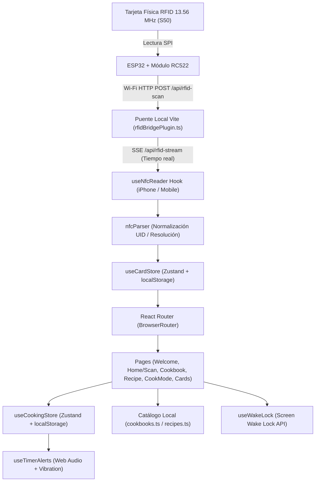

# ChefCard — Arquitectura del Proyecto

## 1. Principios de Diseño Arquitectónico
- **Sin Backend Remoto ni Base de Datos:** El catálogo de libros/recetas vive en TypeScript local y los vínculos `UID ↔ Libro` + progreso se persisten en `localStorage` con Zustand.
- **Puente IoT Ligero en Tiempo Real:** Un plugin liviano de Vite (`rfidBridgePlugin.ts`, sin dependencias extra) expone `POST /api/rfid-scan` para el **ESP32 + RC522** y retransmite cada lectura vía **Server-Sent Events (`GET /api/rfid-stream`)** a cualquier celular (**iPhone** o Android) conectado en la misma red Wi-Fi.
- **Mobile-First Real:** Contenedor optimizado para smartphone (`max-w-md mx-auto min-h-dvh`), controles en *thumb zone* (`>= 44x44px`) y soporte `env(safe-area-inset-bottom)`.
- **Capa RFID:** Las lecturas del **ESP32 + RC522** llegan por SSE a `useNfcReader.ts`; los UID físicos se resuelven con `nfcParser.ts` y los vínculos locales.
- **Resiliencia en Cocina:** Temporizadores basados en `endTime` (timestamp absoluto) para no desfasarse si el celular bloquea la pantalla.

---

## 2. Diagrama de Arquitectura



---

## 3. Estructura de Directorios

```text
ChefCard/
├── CONTEXTO.md                        # Contexto funcional, hardware y alcance MVP
├── ARQUITECTURA.md                    # Este documento (arquitectura y contratos)
├── AGENTS.md                          # Reglas de desarrollo para agentes de código
├── README.md                          # Setup rápido (pnpm + iPhone + ESP32)
├── rfidBridgePlugin.ts                # Plugin Vite: endpoints /api/rfid-scan y /api/rfid-stream (SSE)
├── vite.config.ts                     # React + Tailwind v4 + rfidBridgePlugin + vite-plugin-pwa
├── tsconfig.json                      # Configuración TypeScript estricta
├── package.json
├── firmware/
│   ├── README.md                      # Lista de compras, tabla de pines RC522->ESP32 y setup Arduino IDE
│   └── chefcard_rfid/
│       └── chefcard_rfid.ino          # Sketch listo para cargar al ESP32 + RC522
├── public/
│   └── favicon.svg
└── src/
    ├── main.tsx                       # Punto de entrada React + BrowserRouter
    ├── App.tsx                        # Mapa de rutas, shell móvil y modal tarjeta nueva
    ├── index.css                      # Tailwind CSS v4 + utilidades táctiles
    ├── types/
    │   ├── domain.ts                  # Cookbook, Recipe, Ingredient, Step, CardMapping, ActiveTimer
    ├── data/
    │   ├── cookbooks.ts               # Catálogo de 4 libros de cocina temáticos
    │   └── recipes.ts                 # 8 recetas detalladas con ingredientes, pasos y tiempos
    ├── store/
    │   ├── useCardStore.ts            # Vínculos UID <-> cookbookSlug e historial de escaneos
    │   └── useCookingStore.ts         # Progreso de receta, porciones, checklist y timers
    ├── hooks/
    │   ├── useNfcReader.ts            # Receptor SSE (ESP32 + RC522)
    │   ├── useWakeLock.ts             # Pantalla siempre encendida en Modo Cocina (Fase 3-4)
    │   └── useTimerAlerts.ts          # Tick sobre endTime + Web Audio + vibración (Fase 3-4)
    ├── utils/
    │   ├── nfcParser.ts               # Normalización de UID y prioridad de resolución
    │   └── formatters.ts              # Formateo MM:SS y escalado de ingredientes
    ├── components/
    │   ├── layout/AppShell.tsx        # Contenedor mobile-first + navegación inferior
    │   └── nfc/                       # UnknownCardModal
    └── pages/
        ├── WelcomePage.tsx            # /              -> Pantalla de bienvenida inicial
        ├── HomePage.tsx               # /scan          -> Lector RFID en vivo + libros
        ├── CookbookPage.tsx           # /book/:slug    -> Libro desbloqueado por tarjeta RFID
        ├── RecipeDetailPage.tsx       # /recipe/:id    -> Porciones y mise en place (siguiente fase)
        ├── CookModePage.tsx           # /cook/:id      -> Modo Cocina paso a paso (siguiente fase)
        └── CardsManagerPage.tsx       # /cards         -> Puente ESP32, vínculos UID e historial
```

---

## 4. Rutas de la Aplicación

| Ruta | Pantalla | Rol en el flujo |
| :--- | :--- | :--- |
| `/` | `WelcomePage` | Pantalla de bienvenida sin barra inferior con CTA hacia el lector |
| `/scan` | `HomePage` | Lector activo escuchando al ESP32 + galería de libros |
| `/book/:slug` | `CookbookPage` | Destino automático al pasar una tarjeta física RFID por el RC522 |
| `/recipe/:id` | `RecipeDetailPage` | Vista previa, ajuste de porciones y checklist *mise en place* |
| `/cook/:id` | `CookModePage` | Asistente paso a paso sin distracciones, temporizadores y *Wake Lock* |
| `/cards` | `CardsManagerPage` | Laboratorio RFID: URL del puente ESP32, prueba HTTP, vínculos UID e historial |

---

## 5. Contratos Clave de los Módulos

### A. Protocolo ESP32 ↔ Puente Vite (`rfidBridgePlugin.ts`)
- **Entrada (`POST /api/rfid-scan`):**
  ```json
  { "uid": "A3:4F:12:9B", "device": "esp32-rc522" }
  ```
- **Salida hacia clientes móviles (`GET /api/rfid-stream`, `text/event-stream`):**
  - Evento `connected`: confirma conexión activa al iPhone/navegador.
  - Evento `scan`: envía `{ uid, device, timestamp }` en tiempo real.
  - Heartbeat `: ping` cada 20 segundos para mantener viva la conexión en Safari iOS.

### B. Resolución de Tarjetas (`useNfcReader` + `nfcParser`)
1. Normalización de UID a mayúsculas con dos puntos (`AA:BB:CC:DD`).
2. Busca el UID en `useCardStore`; si aún no está vinculado, `UnknownCardModal` permite asignarlo a un libro.

### C. Persistencia Local (`localStorage`)
- `chefcard-cards-v2`: Vínculos físicos `Record<string, CardMapping>` e historial de los últimos 12 escaneos.
- `chefcard-cooking-v1`: Receta en curso, paso actual, ingredientes marcados, porciones y temporizadores activos.
